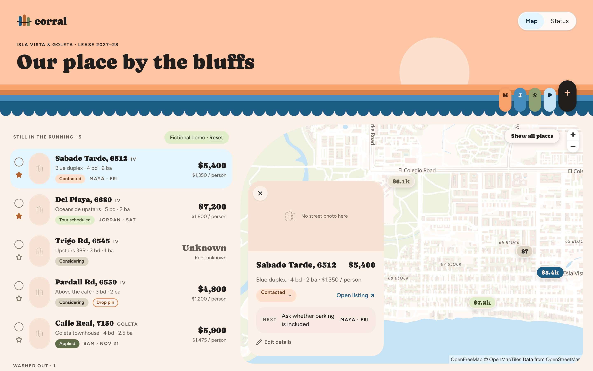
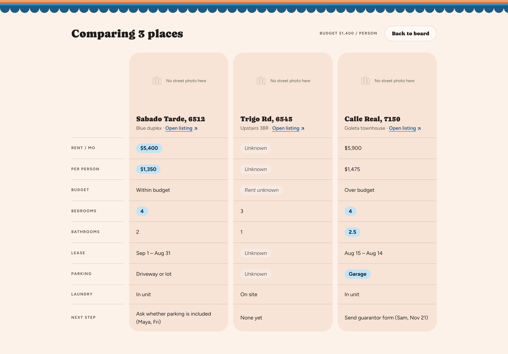
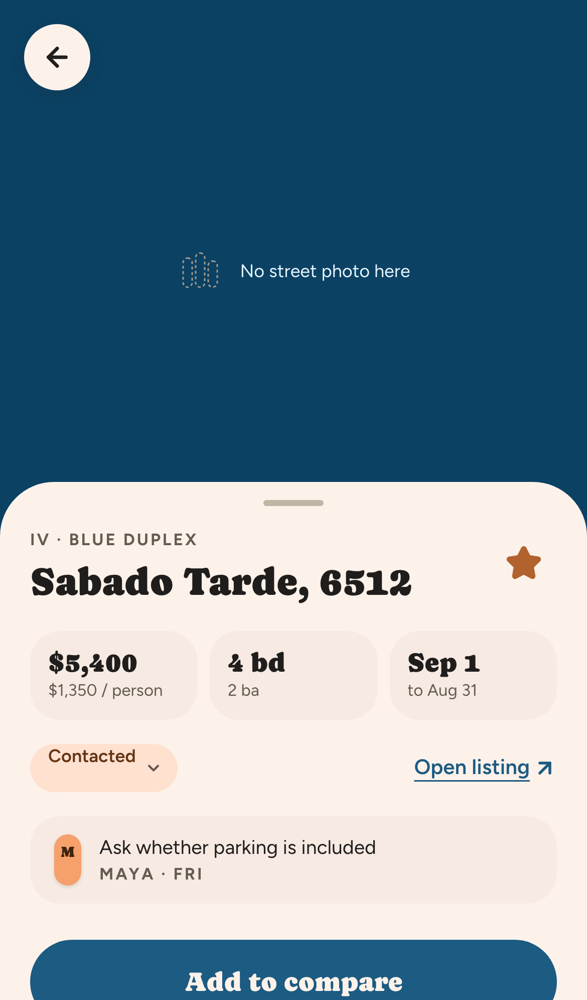
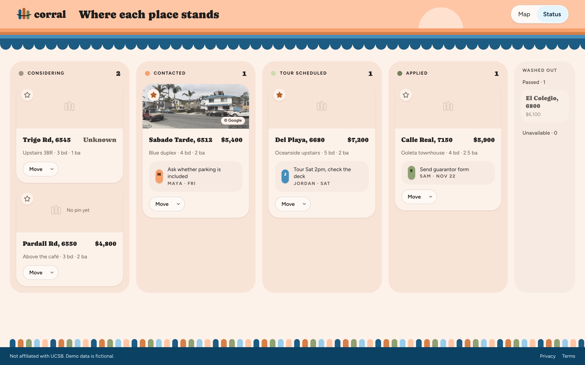

# Corral

[](https://github.com/cmendietaa/corral-housing/actions/workflows/ci.yml)

**One board for a roommate group's housing hunt in Isla Vista and Goleta.**
Save places from any listing site, see them on one map, compare two or three side by side, and give each place a status and one next step with an owner and a due date.

**Live:** https://corral-housing.vercel.app · **Try the demo (no account):** https://corral-housing.vercel.app/demo



## Why

UCSB roommate groups look for a whole house or apartment together, but the search happens in a group chat: links get buried, nobody compares places the same way, and it's unclear who was supposed to call the landlord. Corral keeps the shortlist, the comparison and the follow-ups in one shared place. See [PRD.md](PRD.md) for the product brief.

## What it does

| | |
|---|---|
| **Quick capture** | Paste a link and a name, and you're done. Unknown rent or bedrooms show as *Unknown*, never as $0. Only `http(s)` links are accepted. |
| **Autofill** | Paste the listing's text and the form fills itself in for review. An OpenAI model does it when a key is set, with a rule-based reader as the free fallback. Corral never scrapes or opens listing links. |
| **Linked map** | Rent tags on a MapLibre map, colored by status. Selecting a row selects its tag and the reverse. Pins are placed from the address automatically (US Census Geocoder, OpenStreetMap as fallback, both free); drag a pin to fine-tune it. |
| **Compare** | Check two or three places for a side-by-side table in a fixed row order, with the best value per row highlighted. Unknown rent never counts as "within budget". |
| **Follow-through** | Six PRD statuses (Considering to Unavailable), a shortlist star, and one next step per place with an owner and a due date. A Status tab shows the kanban. |
| **Private boards** | Google sign-in, invite links that expire after 7 days, and Postgres row-level security so only members can read or write a board. |
| **Live + commute** | Roommates' changes appear without reloading (on the demo, open it in two tabs to see it). Each pinned place shows about how long the bike and walk to UCSB is, and Compare highlights the shortest. |
| **Phone-ready** | List, map and status views with a place sheet, all usable at 375px. |

<p>
  
  
</p>



## Architecture

```
app/
  demo/                 Public demo board (localStorage only, never touches the database)
  boards/, boards/[id]  Private boards (server checks the session, RLS decides access)
  invite/[token]        Join a board, or a clear "washed away" page for bad links
  auth/callback|signout OAuth callback and POST-only sign-out
  api/parse-listing     Autofill: OpenAI structured output, rule-based fallback, rate-limited
  api/streetview        Street View proxy (key stays server-side, IV/Goleta area only)
components/board/       One <Board> UI shared by the demo and private boards
lib/stores/             BoardStore interface: local.ts (demo) and supabase.ts (private)
supabase/migrations/    Schema, RLS policies and the create/invite functions
supabase/tests/         rls_check.sql: owner, invited member, outsider and anon checks
```

- **One UI, two stores.** `<Board>` takes a `BoardStore`. The demo uses localStorage and private boards use Supabase, so the demo never imports the database client and both get identical behavior.
- **Access is enforced in Postgres, not the UI.** Every table has RLS keyed on board membership. Users can't insert themselves into `board_members`; the only ways in are `create_board()` and `redeem_invite()`. Column-level grants stop members from changing their role or moving a place to another board. `supabase/tests/rls_check.sql` proves it in a rolled-back transaction with fake users.
- **Sign-in** uses Google Identity Services with `signInWithIdToken` and a hashed nonce, so Google's consent screen names this site. Sessions refresh in `proxy.ts` and are verified server-side with `getClaims()`.
- **Autofill output is untrusted.** Whether it comes from the model or the parser, every field is re-validated against the same Zod schema as the form, and the person reviews it before saving. The model is told to treat pasted text as data, never instructions.

## Tradeoffs and decisions

- **Google sign-in only.** Supabase's built-in email sender is rate-limited, so magic links could fail during a review.
- **One next step per place**, stored on the listing rather than in its own table. It matches the PRD and keeps RLS to one check per table.
- **No scraping.** Listing sites block it and it's fragile, so autofill reads only text people paste.
- **Live updates reload the snapshot.** Supabase Realtime streams listing and member changes (filtered by RLS, so only members hear them); the board refetches after a 300 ms debounce instead of merging events, which is simpler and fine at a few changes a day.
- **Commute is an estimate, not a route.** Straight-line distance to the Pardall entrance times 1.3, at walking and biking speeds. No paid directions API, and it's always shown as "about".
- **Per-person rent divides by group size**, not bedrooms, because the group splits the rent.
- **MapLibre v5 with OpenFreeMap tiles.** No API key, styled to the palette. v6's ES-module worker doesn't load through Next's bundler, so it stays pinned to v5.
- **Street View is optional and fenced in.** Photos go through a server proxy so the key never reaches the browser, only coordinates around Isla Vista and Goleta are allowed, and the key is restricted to the Street View Static API with a daily cap. Without `GOOGLE_MAPS_API_KEY`, frames show a neutral placeholder and no request is made.

## Run it locally

```bash
npm install
cp .env.example .env.local   # every variable is optional; with none set, only /demo works
npm run dev
```

| Variable | Enables |
|---|---|
| `NEXT_PUBLIC_SUPABASE_URL`, `NEXT_PUBLIC_SUPABASE_PUBLISHABLE_KEY` | Sign-in and private boards |
| `NEXT_PUBLIC_GOOGLE_CLIENT_ID` | Google's own sign-in button (otherwise the redirect flow) |
| `OPENAI_API_KEY` (optional `OPENAI_MODEL`) | AI autofill (otherwise the rule-based reader) |
| `GOOGLE_MAPS_API_KEY` | Street View photos |

Apply the database schema to your own Supabase project with `supabase link` and then `supabase db push --remote`.

## Tests

```bash
npm run lint && npm test && npm run build                       # 72 unit tests (Vitest)
npm run test:e2e                                                # 24 Playwright tests, desktop and iPhone
E2E_BASE_URL=https://corral-housing.vercel.app npm run test:e2e # same, against production
supabase db query --remote -f supabase/tests/rls_check.sql     # RLS checks, rolled back
```

## Stack

Next.js 16 (App Router) · React 19 · TypeScript · Tailwind v4 · Supabase (Google auth, Postgres, RLS) · MapLibre GL + OpenFreeMap · Zod · OpenAI (structured output) · Vitest · Playwright · Vercel

---

Not affiliated with UCSB. Demo data is fictional. See [PLAN.md](PLAN.md) for the build plan.
