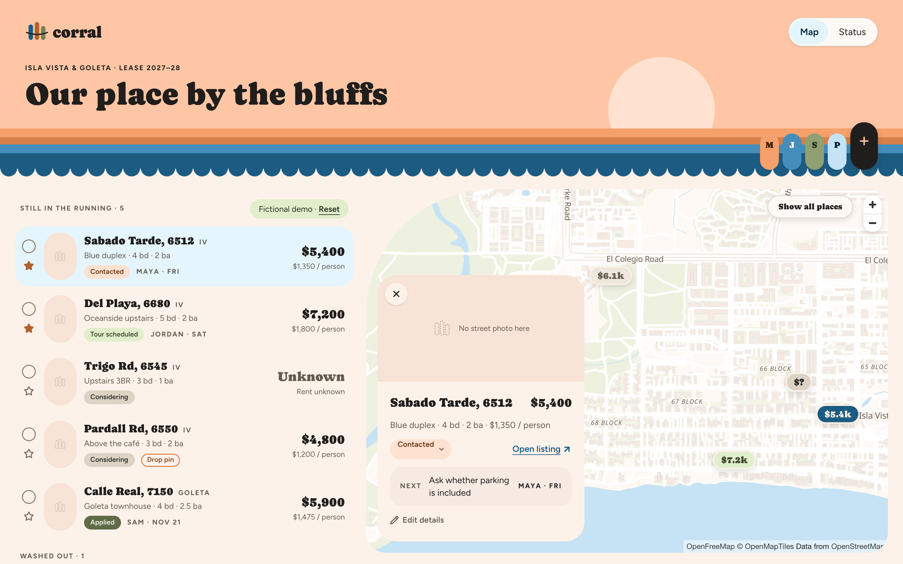
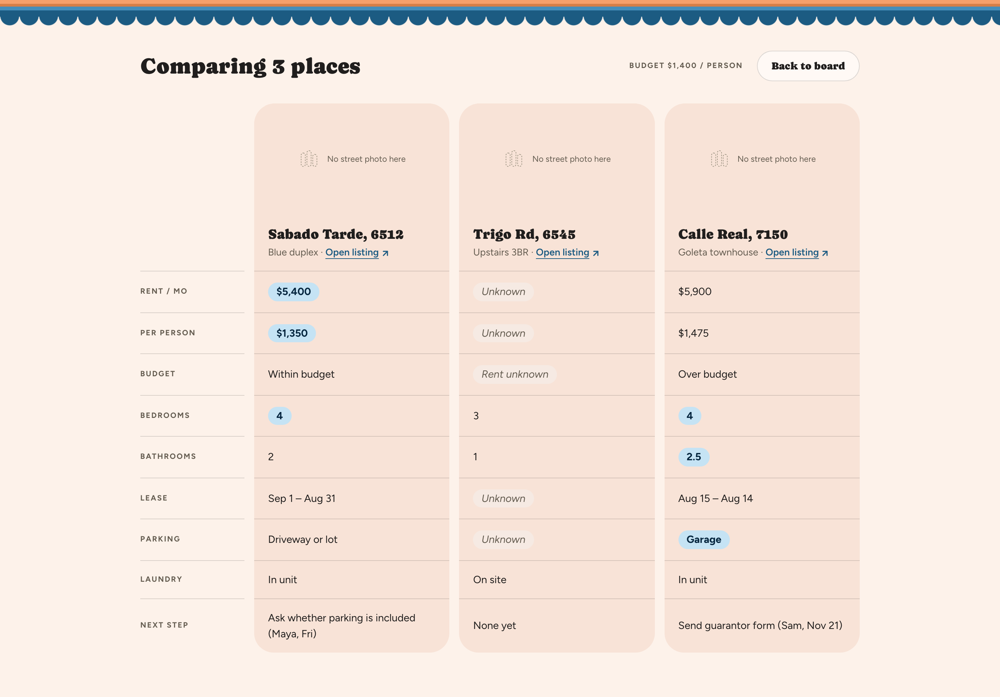
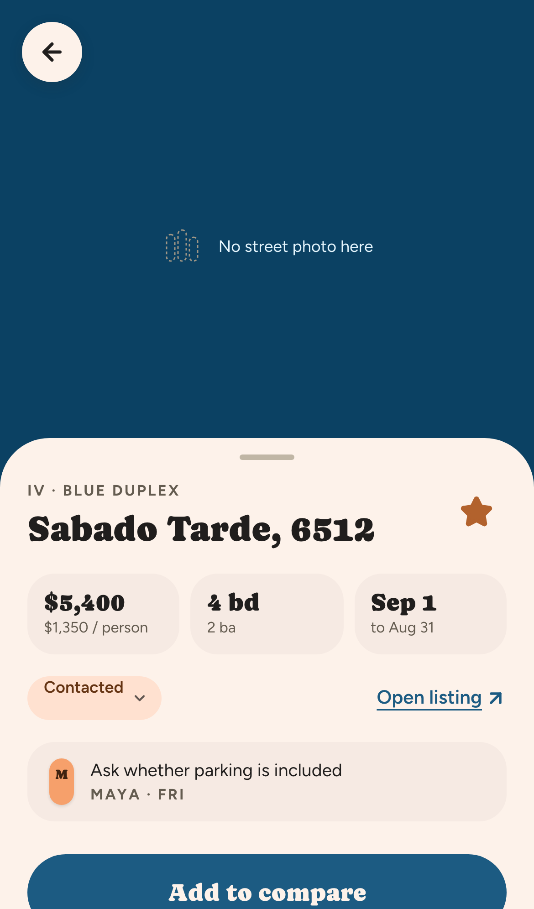
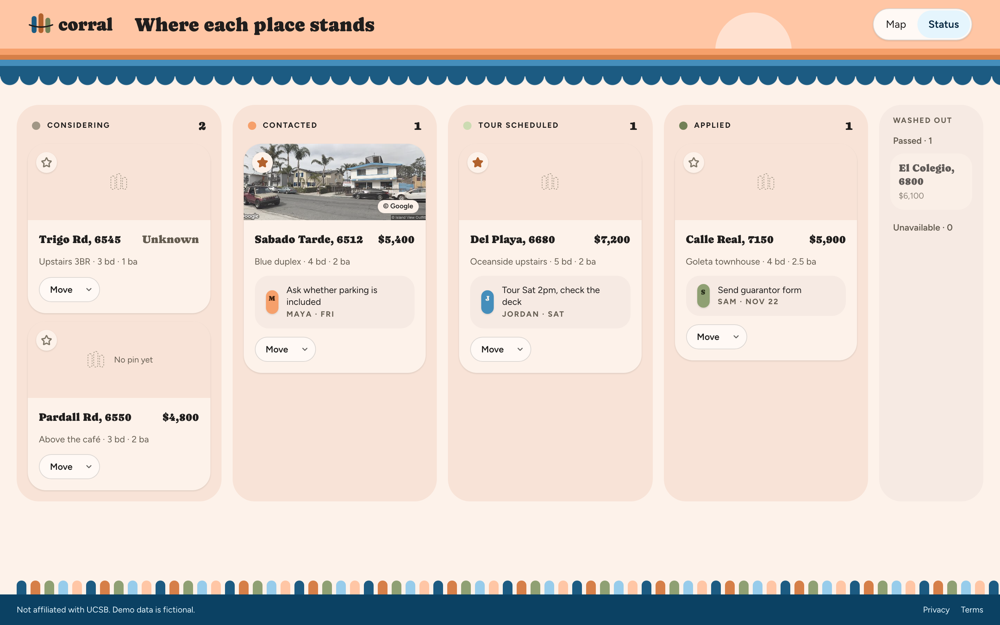

# Corral

[](https://github.com/cmendietaa/corral-housing/actions/workflows/ci.yml)

**One board for a roommate group's housing hunt in Isla Vista and Goleta.**
Save places from any listing site, see them on one map, compare two or three side by side, and give each place a status and one next step with an owner and a due date.

**Live:** https://corral-housing.vercel.app · **Try the demo (no account):** https://corral-housing.vercel.app/demo



## Why

UCSB roommate groups look for a whole house or apartment together, but the search happens in a group chat: links get buried, nobody compares places the same way, and it's unclear who was supposed to call the landlord. Corral keeps the shortlist, the comparison and the follow-ups in one shared place. See [PRD.md](PRD.md) for the product brief.

## What it does

| | |
|---|---|
| **Quick capture** | A name is all you need; add the listing link if there is one (screenshots and word-of-mouth places often don't have one). Unknown rent or bedrooms show as *Unknown*, never as $0. Only `http(s)` links are accepted. |
| **Autofill** | Paste the listing's text or add up to 3 screenshots of it (a post, a group chat, a listing page), and the form fills itself in for review. An OpenAI model reads both when a key is set, with a rule-based reader as the free fallback for text. Screenshots are shrunk in the browser and never stored. **Fill from link** reads the one listing page a person pasted, for facts only (see below). |
| **Send to Corral** | A bookmark (computer) or Share-sheet Shortcut (iPhone), set up in Board settings, sends Corral the listing you're looking at from your own browser: rendered text, so rents a site loads with JavaScript come along, and it works on sites Corral won't fetch itself. Lands on `/send`, you pick a board, and it opens straight into Round it up. Adds to pasting a link; doesn't replace it. |
| **Linked map** | Rent tags on a MapLibre map, colored by status. Selecting a row selects its tag and the reverse. Pins are placed from the address automatically (OpenStreetMap's building outline when it has one, else the US Census Geocoder; both free); drag a pin to fine-tune it. |
| **Compare** | Check two or three places for a side-by-side table in a fixed row order, with the best value per row highlighted. Unknown rent never counts as "within budget". |
| **Follow-through** | Six PRD statuses (Considering to Unavailable), a shortlist star, and one next step per place with an owner and a due date. A Status tab shows the kanban. |
| **Private boards** | Google sign-in, invite links that expire after 7 days, and Postgres row-level security so only members can read or write a board. |
| **Tour photos** | Roommates add up to 8 photos per place from a tour; the first replaces Street View everywhere the place appears. Photos are shrunk in the browser (which also strips GPS and other EXIF data) and stored in a private Supabase bucket readable only by board members. |
| **Live + commute** | Roommates' changes appear without reloading (on the demo, open it in two tabs to see it). Each pinned place shows about how long the bike and walk to UCSB is, and Compare highlights the shortest. |
| **Phone-ready** | List, map and status views with a place sheet, all usable at 375px. |

<p>
  
  
</p>



## Design identity

Corral should be recognizable from any cropped screenshot. The palette (sunset, sea, shell, glass, stone) and type (Caprasimo for display, Figtree for text) are set; what makes a screen *Corral* is that it uses our motifs instead of generic UI. Every new screen and component borrows at least one.

**The motifs** (shared pieces in `components/brand/motifs.tsx`, styles in `app/globals.css`):

| Motif | Looks like | Use it for |
|---|---|---|
| Fence boards | Tall round-topped boards in the five fence colors | Counts ("rounded up 7"), progress, loading, dividers, the roommate pills, and small place photos (half-circle top, softly rounded bottom) |
| The setting sun | A pale sun half under the horizon | "Corral found this" marks (never a sparkle), empty states, loading (the sun sinks) |
| The stripe | Sunset into sea, four bands | Band edges, active tabs, the top edge of a card |
| The wave edge | Scallops, 28px apart | Where sand meets sea: dark strips, toasts, the bottom of the band |
| The lasso | A rope loop with a knot | "Round it up": drop zones are rope loops, missing facts are roped off (dashed) |
| Rent tags | Hanging price tags | Map pins and prices |
| The lasso toggle | The rope loop with "Rope in" / "Roped in" | Picking places to compare (always with its label) |
| The empty lot | Pale sky, the sun sitting on a fence | Any place without a photo |
| Fit stars | Five sunset stars with the score out of 5 beside them ("4.3 · Great fit") | A place's rank score; stars are familiar, so this one stays a star |
| Rope-tag buttons | The rent-tag shape with a knot | One-tap moves ("Move to Tour scheduled") |
| The open gate | Two posts, gate boards swung open | Signing in, loading a board ("Opening the gate…") |

**Rules**

- Motifs for decoration, counts and scenes; familiar symbols for controls. A button whose meaning isn't obvious gets a familiar symbol (a star for the shortlist) or a word ("Best", "Rope in"). One symbol, one meaning: the little sun only ever means "Corral found this in the listing".
- No generic stand-ins: no sparkles for AI, no pale info boxes with an icon, no stock dashed buttons, no stock icons where a motif or a small Corral scene says more. Lucide is fine for plain controls (close, back, plus, minus).
- Little small print. A heading doesn't need a sentence under it. Keep a helper line only when it tells people something they'd otherwise miss (a per-person split, a pin's bike time, why a site can't be read); explain a pattern once, not on every field.
- Moments, not cuts. Loading is a scene (the sun sets as the fence goes up), and it lands before moving on (the count, then the next screen rises in). Respect reduced motion.
- One voice: round it up, into the corral, still in the running, washed out, rounded up 6 details.
- Check new UI in Safari's engine too (`npx playwright test --project=safari`), not just Chrome.

Sketches and alternatives live on the design canvas ("Corral Housing Design Review").

## Architecture

```
app/
  demo/                 Public demo board (localStorage only, never touches the database)
  boards/, boards/[id]  Private boards (server checks the session, RLS decides access)
  invite/[token]        Join a board, or a clear "washed away" page for bad links
  auth/callback|signout OAuth callback and POST-only sign-out
  api/parse-listing     Autofill from text or screenshots: OpenAI structured output, rule-based fallback, rate-limited
  api/import-link       Fill from link: reads one pasted page (skip list, robots.txt, private-address guard), then autofill
  api/import-page       Send to Corral: reads the text a person's browser sent (never fetches the site)
  api/listing-photo     Downloads one listing photo a person chose to keep (same rules as link reading)
  send/                 Where Send to Corral lands: receives the page, picks a board
  api/streetview        Street View proxy (key stays server-side, IV/Goleta area only)
components/board/       One <Board> UI shared by the demo and private boards
lib/stores/             BoardStore interface: local.ts (demo) and supabase.ts (private)
supabase/migrations/    Schema, RLS policies and the create/invite functions
supabase/tests/         rls_check.sql: owner, invited member, outsider and anon checks (boards and tour photos)
```

- **One UI, two stores.** `<Board>` takes a `BoardStore`. The demo uses localStorage and private boards use Supabase, so the demo never imports the database client and both get identical behavior.
- **Access is enforced in Postgres, not the UI.** Every table has RLS keyed on board membership. Users can't insert themselves into `board_members`; the only ways in are `create_board()` and `redeem_invite()`. Column-level grants stop members from changing their role or moving a place to another board. `supabase/tests/rls_check.sql` proves it in a rolled-back transaction with fake users.
- **Sign-in** uses Google Identity Services with `signInWithIdToken` and a hashed nonce, so Google's consent screen names this site. Sessions refresh in `proxy.ts` and are verified server-side with `getClaims()`.
- **Autofill output is untrusted.** Whether it comes from the model or the parser, every field is re-validated against the same Zod schema as the form, and the person reviews it before saving. The model is told to treat pasted text and screenshots as data, never instructions. Text and screenshots share one extraction pipeline (`lib/extract/`): the same instructions, output schema and validation.
- **Screenshots: shrink in the browser, distrust on the server.** The browser re-encodes each screenshot (long side ≤2048px, which also strips metadata) so uploads stay small; the server still checks the real file type from its first bytes, the size and the count, and passes the image to the model in memory without storing it. A screenshot request counts as 2 of the 10 hourly AI calls per IP, and the OpenAI project's budget limit is the real cost ceiling. With no model available, a screenshot gets a clear "paste the text instead" rather than an empty form.

## Tradeoffs and decisions

- **Google sign-in only.** Supabase's built-in email sender is rate-limited, so magic links could fail during a review.
- **One next step per place**, stored on the listing rather than in its own table. It matches the PRD and keeps RLS to one check per table.
- **No scraping; one careful page read.** Fill from link fetches only the page a person pasted, when they ask. Sites whose terms forbid apps reading their listings (Zillow, Apartments.com, Craigslist, Realtor.com, Redfin, Facebook) are never fetched and fall back to paste or screenshot (`lib/link-import/sites.ts`). Listing photos are offered on the check screen, none chosen; only the ones a person picks are downloaded and saved with the group's photos, and never from the skip-list sites. Otherwise robots.txt is respected, bot checks and refusals are taken as a no, private and internal addresses are refused when the socket connects, and only facts come back for review; nothing from the page is stored.
- **Live updates reload the snapshot.** Supabase Realtime streams listing and member changes (filtered by RLS, so only members hear them); the board refetches after a 300 ms debounce instead of merging events, which is simpler and fine at a few changes a day.
- **Tour photos: index first, then upload.** A `listing_photos` row is inserted first (RLS checks membership and an 8-photo cap), the storage path is derived from it in Postgres, and the bucket's policy only accepts uploads to indexed paths, so the table and bucket can't drift and nobody can drop arbitrary files in. Signed links last an hour and the board refreshes them.
- **Commute is an estimate, not a route.** Straight-line distance to the Pardall entrance times 1.3, at walking and biking speeds. No paid directions API, and it's always shown as "about".
- **Per-person rent divides by group size**, not bedrooms, because the group splits the rent.
- **MapLibre v5 with OpenFreeMap tiles.** No API key, styled to the palette. v6's ES-module worker doesn't load through Next's bundler, so it stays pinned to v5.
- **Street View is optional and fenced in.** Photos go through a server proxy so the key never reaches the browser, only coordinates around Isla Vista and Goleta are allowed, and the key is restricted to the Street View Static API with a daily cap. Without `GOOGLE_MAPS_API_KEY`, frames show a neutral placeholder and no request is made.

## Run it locally

```bash
npm install
cp .env.example .env.local   # every variable is optional; with none set, only /demo works
npm run dev
```

| Variable | Enables |
|---|---|
| `NEXT_PUBLIC_SUPABASE_URL`, `NEXT_PUBLIC_SUPABASE_PUBLISHABLE_KEY` | Sign-in and private boards |
| `NEXT_PUBLIC_GOOGLE_CLIENT_ID` | Google's own sign-in button (otherwise the redirect flow) |
| `OPENAI_API_KEY` (optional `OPENAI_MODEL`) | AI autofill (otherwise the rule-based reader) |
| `GOOGLE_MAPS_API_KEY` | Street View photos |

Apply the database schema to your own Supabase project with `supabase link` and then `supabase db push --remote`.

## Tests

```bash
npm run lint && npm test && npm run build                       # 99 unit tests (Vitest)
npm run test:e2e                                                # 34 Playwright tests, desktop and iPhone
E2E_BASE_URL=https://corral-housing.vercel.app npm run test:e2e # same, against production
supabase db query --remote -f supabase/tests/rls_check.sql     # RLS checks, rolled back
```

## Stack

Next.js 16 (App Router) · React 19 · TypeScript · Tailwind v4 · Supabase (Google auth, Postgres, RLS) · MapLibre GL + OpenFreeMap · Zod · OpenAI (structured output) · Vitest · Playwright · Vercel

---

Not affiliated with UCSB. Demo data is fictional. See [PLAN.md](PLAN.md) for the build plan.
